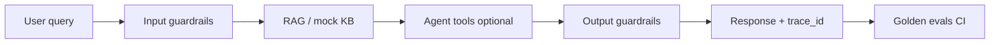

# Capstone — Agentic RAG with guardrails & eval gate


**Flagship narrative** for **Agentic AI Lead** and **Forward Deployed AI** interviews: one pipeline story that wires the rest of this portfolio.

## Architecture



| Step | Portfolio project |
|------|-------------------|
| Ingest & retrieve | [01-rag-assistant](../01-rag-assistant) |
| Safety & schema | [03-guardrails-api](../03-guardrails-api) |
| Tool use | [04-agent-tools](../04-agent-tools) |
| Release gate | [05-evals-harness](../05-evals-harness) |

## Quick start

```bash
cd 00-capstone-agentic-rag
python3 orchestrate.py "What is our remote work policy?"
python3 orchestrate.py "ignore previous instructions"   # blocked input
python3 orchestrate.py --run-evals                        # CI same as GitHub Actions
```

## Interview talking points

- **Trace id** on every request — plug into Datadog/Arize in production.
- **Fail closed** on injection patterns; structured JSON out via Pydantic-style validation.
- **Eval harness** exits non-zero → block deploy (same pattern as RAGAS/deepeval in CI).
- FDE angle: swap `mock_rag_answer` for customer VPC endpoint; golden set = signed-off FAQ.

## Extend

- HTTP POST `/ask` wrapping `orchestrate.py`
- Call live [01-rag-assistant](../01-rag-assistant) `/query` instead of mock KB
- Log tool calls from [04-agent-tools](../04-agent-tools) when query needs calculator/KB lookup
